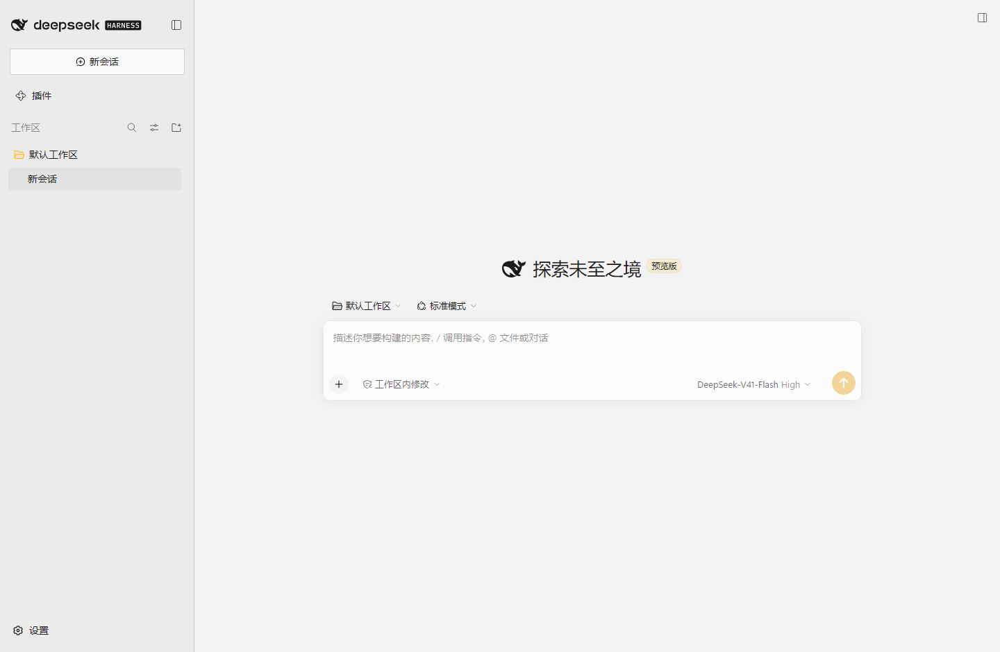
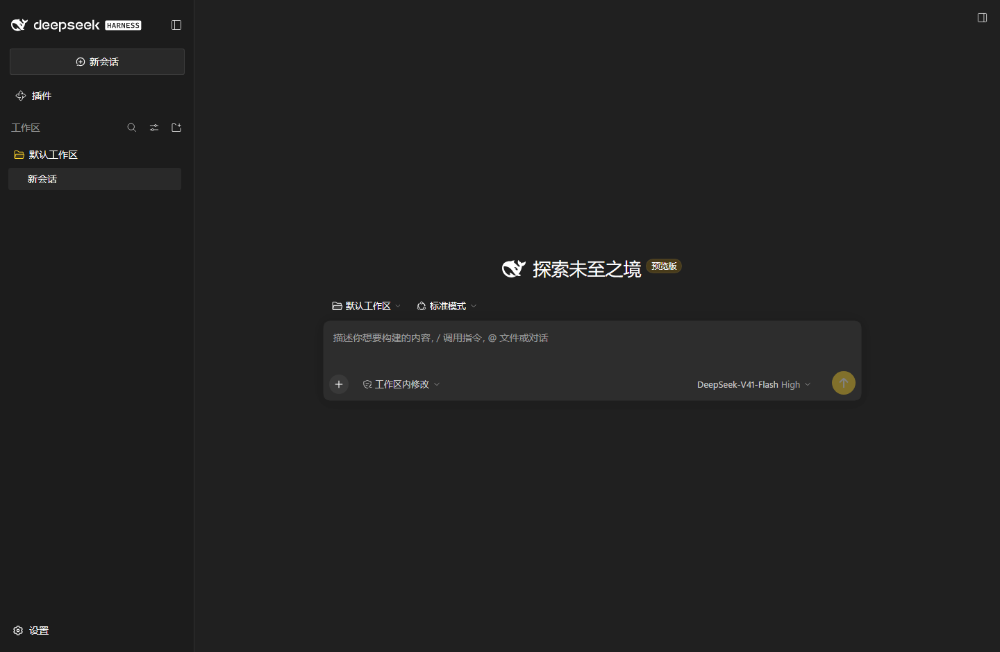
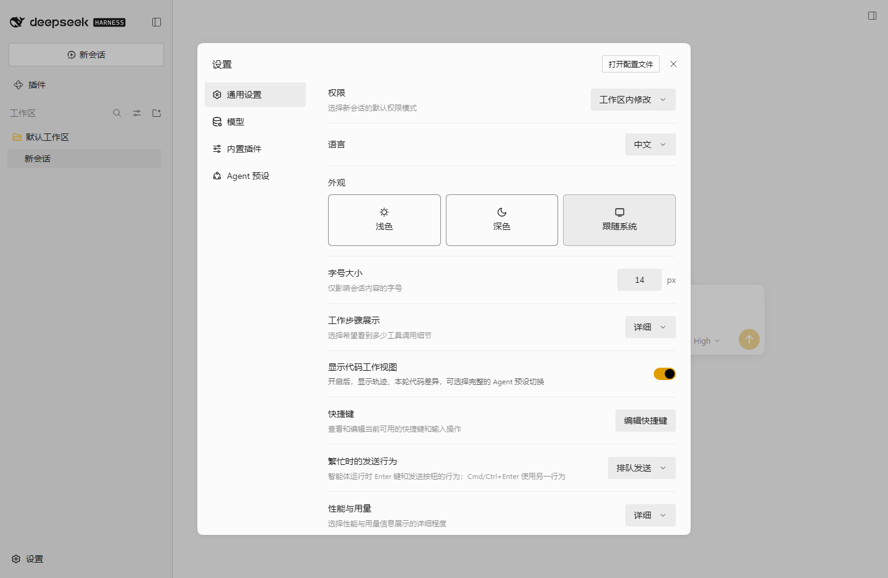
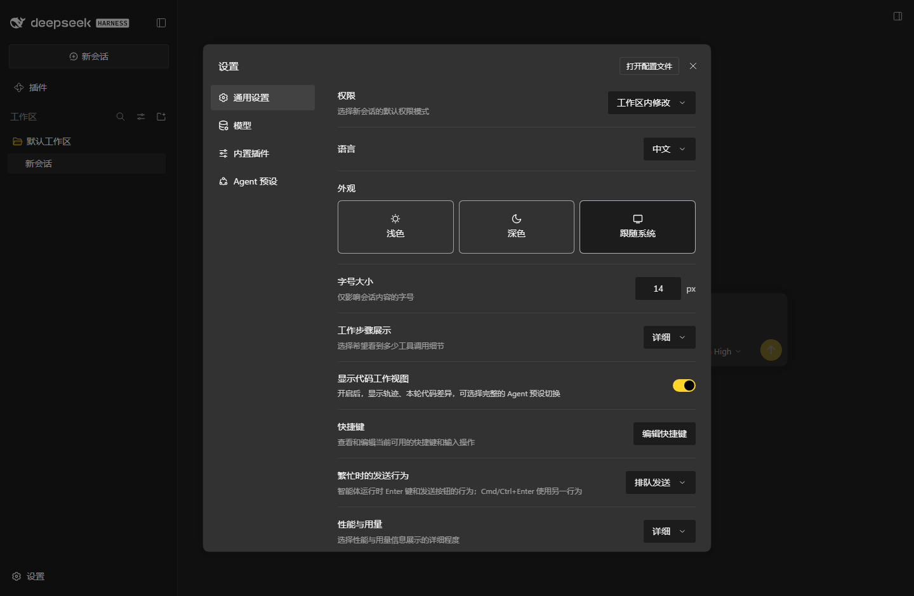

# dsh-winui-skin

[](https://github.com/LJY7812/dsh-winui-skin/actions/workflows/ci.yml)

给 DeepSeek Harness 的 Web / Desktop 客户端换上一套 **Windows 11 / WinUI 3（Fluent 2）** 皮肤。

插件是 host + client 两半：

1. **host 半边读系统强调色**：用 `reg query` 读 Windows 写强调色的注册表键，通过 `/api/dsh-winui-accent` 这个 loopback 路由交给浏览器半边（读不到就答 `supported:false`；全程 try/catch，绝不会拖垮宿主）。
2. **client 半边叠加 Fluent token 层**：通过 `ctx.theme.overrideTokens()` 把 133 个 DSH 设计 token 覆盖成 WinUI 3 的官方色板与几何值，每个 token 都给出 `{ light, dark }` 一对取值；强调色相关的那批按 host 报来的色阶填。
3. **注入一份插件自有样式表**：负责颜色 token 表达不了的部分——Fluent 字体栈、Windows 11 细滚动条、焦点矩形、Mica 画布层次、亚克力弹出层描边。

色值取自 WinUI 3 源码的 `Common_themeresources_any.xaml`（注意其中有 `x:Key="Default"` 的才是**深色**字典）、`CornerRadius_themeresources.xaml`、`AcrylicBrush_themeresources.xaml`、`ListViewItem_themeresources.xaml`、`TextBlock_themeresources.xaml` 与 `FocusRectManager.cpp`；强调色阶直接取自系统本身。

卸载时 token 层与样式表一起回收，路由随 host 半边一起撤销，外观立刻回到 DSH 原样。

## 预览

| 浅色 | 深色 |
| --- | --- |
|  |  |
|  |  |

`docs/preview/` 里还有首次运行弹窗与**卸载后**的原版对照图 `07-unloaded.png`。

截图用的是本机的真实系统强调色（金色 `#FFB900`）——所以按钮、开关、链接、选中态都是金色的，而不是 WinUI 默认蓝。

## 跟随系统配色

**浅色 / 深色**：DSH 外观设置里的「跟随系统」本来就走 `prefers-color-scheme`，本皮肤对两套色板同时生效，所以它一直是跟随的。

**系统强调色**：这一项走了弯路，值得说清楚。

网页唯一"看似"能读到系统强调色的途径是 CSS 系统色关键字 `AccentColor`。但实测在 Windows 11 上**它并不反映你的强调色**：

| 来源 | 值 |
| --- | --- |
| `UISettings.GetColorValue(UIColorType.Accent)`（权威） | `#FFB900` 金色 |
| `HKCU\...\Explorer\Accent\AccentPalette` | Light3 `#FFE845` → Accent `#FFB900` → Dark3 `#5C2100` |
| Chromium 的 CSS `AccentColor` | `rgb(0, 117, 255)` 蓝色 ❌ |

所以第一版"跟随系统"是假的：皮肤一直是蓝的。现在改成由 **host 半边读注册表**：

1. host 半边用 `reg query` 读 `HKCU\Software\Microsoft\Windows\CurrentVersion\Explorer\Accent\AccentPalette`（8 个 `RRGGBBAA`，与 WinRT 报的色阶逐位一致），5 秒缓存，读不到就答 `{"supported":false}`；
2. 通过 `/api/dsh-winui-accent` 这个 loopback 路由交给浏览器半边；
3. 浏览器半边按 WinUI 自己对 `SystemAccentColor` 的映射落到 token 上：
   - 浅色填充 = `AccentDark1`，深色填充 = `AccentLight2`
   - 强调文字（链接）= `AccentDark2` / `AccentLight3`
   - 按钮上的文字用 WCAG 相对亮度选黑或白，保证 ≥ 4.5:1
4. 页面先铺 WinUI 默认蓝避免闪烁，拿到真实色阶后再重铺一层；窗口重新聚焦、页面重新可见、每 20 秒各复查一次。

读不到注册表（非 Windows、被策略锁死、将来换实现）时回退到 WinUI 默认蓝，不会出现"半跟随"的诡异配色。

> 想固定成 WinUI 默认蓝：把 `lib/client.js` 里 `fetchSystemAccent()` 直接返回 `undefined` 即可。
>
> Windows 改强调色时不会触发任何事件，最坏 20 秒后才反映；刷新一次页面会立刻同步。

## 为什么是「token 覆盖层」而不是「第三个主题」

DSH 的外观设置只有 `浅色 / 深色 / 跟随系统` 三档，第三方主题 id 是进程内扩展、不会写进设置 schema。因此本插件不注册新主题，而是**同时重绘浅色与深色两套色板**：无论用户选哪一档、系统如何切换，WinUI 皮肤都生效。

覆盖层由 ui-layout 以 inline custom property 的形式写到 `<body>` 上，因此优先级高于 ui-theme 自带的 `body` / `body[data-ds-dark-theme]` 规则，切换亮暗主题也不会丢。

## 换掉了什么

| 方面 | 原 DSH | 本皮肤（WinUI 3 / Fluent 2） |
| --- | --- | --- |
| 字体 | `-apple-system, BlinkMacSystemFont, "Segoe UI", …` | `Segoe UI Variable Text / Display` → `Segoe UI` → `Microsoft YaHei UI` |
| 代码字体 | `SF Mono, JetBrains Mono, …` | `Cascadia Code / Cascadia Mono` → `Consolas` |
| 画布底色 | 浅色 `#fff` / 深色 `#151517` | `SolidBackgroundFillColorBase`：`#f3f3f3` / `#202020`（Mica 底） |
| 侧栏 | `#f9fafb` / `#1b1b1c` | NavigationView 窗格：`#ebebeb` / `#1c1c1c` |
| 卡片 / 浮层 | 纯白 / `#232324` | `CardBackgroundFillColorDefault`：`#ffffff` / `#2c2c2c`，配 `CardStrokeColorDefault` 发丝描边 |
| 控件填充 | 不透明 | `ControlFillColorDefault`：`rgba(255,255,255,.7)` / `rgba(255,255,255,.0605)` |
| 描边 | `rgba(0,0,0,.04)…` | `ControlStrokeColorDefault` / `DividerStrokeColorDefault` / `ControlStrokeColorSecondary` / `ControlStrongStrokeColorDefault` |
| 正文 / 次级 / 三级文字 | 中性灰阶 | `TextFillColorPrimary/Secondary/Tertiary/Disabled` |
| 强调色 | 近黑 / 近白 | **跟随系统强调色**（`AccentColor`），按 WinUI 映射推导明暗色阶；读不到时回退 `AccentFillColorDefault`（浅 `#0067c0` + 白字 / 深 `#4cc2ff` + 黑字），链接取 `AccentTextFillColorPrimary`：`#003e92` / `#99ebff` |
| 语义色 | 自定义红绿黄 | `SystemFillColorSuccess/Caution/Critical` 及配套底色 |
| 圆角 | xs4 / sm8 / md12 / lg16 / xl20 / panel28 | 保留原有的**递进比例**、整体缩到 WinUI 的两个锚点（`ControlCornerRadius` 4 / `OverlayCornerRadius` 8）：2 / 4 / 4 / 8 / 8 / 12。大面板留在 12px，否则 800px 的弹窗和 774px 的输入框会像方块；侧栏行与图标按钮统一 4px，不再出现 4px 和 5px 并排的"差一像素"感 |
| 焦点环 | 蓝色 2px | 颜色换成 `FocusStrokeColorOuter`（近黑 / 近白），宽度 2px；**几何与抑制规则仍由 DSH 自己管**（自动聚焦元素、指针模态下不画环） |
| 滚动条 | 5px 细条 | Windows 11 系统滚动条：12px 轨道、2px 圆角滑块，悬停 6px、拖动 8px |
| 弹出层 | `blur(40px) saturate(150%)` | 亚克力 `blur(30px) saturate(125%)` + `SurfaceStrokeColorFlyout` 发丝描边（不是 `SurfaceStrokeColorDefault`） |
| 阴影 | 三层大模糊 | Flyout 尺寸的小阴影 + 1px 描边（Fluent 立面） |
| 设置卡片 | `border-l4` 描边 | 单独重绑到 `CardStrokeColorDefault`，比原来轻得多 |
| 原生标题栏 | 由 `--dsw-specific-sidebar-fill` 决定 | 随皮肤一起变成 WinUI 窗格色（DSH 会把该 token 同步给 Electron `titleBarOverlay`） |

## 安装

前置：DSH 的 Desktop/Web 客户端，profile 目录可写。

```powershell
git clone https://github.com/LJY7812/dsh-winui-skin.git
cd dsh-winui-skin
.\install.cmd                      # 安装进当前 profile（默认 desktop）
.\install.cmd -Profile web         # 或指定 profile
```

脚本做三件事：把 `package.json` / `cordis.patch.yml` / `lib` / `README.md` 复制到
`<profile>\node_modules\dsh-winui-skin`；在 profile `package.json` 的
`dependencies` 里登记包名；把包名追加到 `dsh.profile.bundles`。
原有的 `package.json` 会先备份为 `package.json.before-dsh-winui-skin`。

脚本没有数字签名，`.cmd` 包装器已经带上 `-ExecutionPolicy Bypass`。直接调用 `.ps1` 时请自己加：

```powershell
powershell -NoProfile -ExecutionPolicy Bypass -File .\install.ps1
```

安装完成后 DSH 会重新组合该 profile（`dsh-hmr` 监听 profile manifest），页面会重新拉取客户端 bundle 并立即套用皮肤。若几秒内没变化，刷新一次页面即可；只有在极端情况下才需要重启 DSH。

> 也可以用 `dsh plugin --profile <name> add <本目录绝对路径>` 安装：它会把包加进 profile 依赖，
> 之后仍需把 `dsh-winui-skin` 选进 `dsh.profile.bundles`（本仓库的 `install.cmd` 两步都做了）。

## 卸载

```powershell
.\uninstall.cmd
```

从 `dsh.profile.bundles` 与 `dependencies` 中移除、删除 `node_modules\dsh-winui-skin`，
并把插件自带的 token 层与样式表一起回收。

## 验证方式

皮肤不是"装上就算完"，下面这些检查都实跑过：

1. **契约测试**（`node tools/test-skin.mjs`，CI 也会跑，共 60 项）：按 DSH 浏览器的加载方式注册 module、执行
   `apply`、校验两个 effect 与回收函数；用 `tools/design-tokens.txt`（从 ui-theme 样式表、构建产物、
   UI primitives 里抽取并冻结的 457 个真实自定义属性名）逐个核对 133 个覆盖 token 名；校验 host 半边的
   `AccentPalette` 解码（含截断 / 缺失 / 全零三种拒绝路径）；对**真实金色色阶**与 WinUI 回退色各算一遍 WCAG
   对比度（按钮文字、链接对画布、引导页按钮都要 ≥ 4.5:1）；并断言圆角阶梯单调不降。
2. **系统色来源核对**：`node tools/probe-system-colors.mjs` 确认引擎怎么解析 `AccentColor`（在这台机器上
   它给出蓝色，而 WinRT 给出金色——这就是必须走注册表的原因）。
3. **组合验证**：在隔离 `DSH_HOME` 里用 web 模板建 profile → 装本插件 → `dsh --dump-config`
   能打印出 `# == dsh-winui-skin` 层与 `id: winui-skin` 行。
4. **端到端验证**：真启动该 profile，`/` 的 boot combo 里出现 `dsh-winui-skin/client.js`，
   取回该 combo 确认服务端返回的正是本 bundle；再从页面里 fetch `/api/dsh-winui-accent`，
   确认路由返回的色阶与注册表一致。
5. **渲染与运行时验证**（`node tools/verify-visual.mjs "<带 token 的 URL>"`，headless Edge + CDP）：
   浅色 / 深色 / 设置页 / 卸载后多态截图（见 `docs/preview/`），确认 `<body>` 上 133 个内联 token、
   1 个 `data-plugin="dsh-winui-skin"` 样式表、**0 个页面异常**；还会列出**每个圆角 token 实际被哪些元素使用**
   （把六个 token 换成互不相同的哨兵值再统计），以及页面上的焦点环清单。卸载后 `--dsw-alias-bg-base`
   回到 `#fff`、`--dsw-radius-panel` 回到 `28px`，证明外观确实来自本插件且回收干净。

## 已知边界

- **字体依赖系统**：`Segoe UI Variable` / `Cascadia Code` 是 Windows 11 自带字体。Windows 10 上会自动回退到 `Segoe UI` / `Consolas`，观感差异不大。
- **强调色靠注册表读取**：非 Windows、或被策略锁死注册表时回退到 WinUI 默认蓝，不会出现"半跟随"的诡异配色。
- **改强调色不是即时的**：Windows 不触发任何事件，皮肤靠重新聚焦、页面可见、以及 20 秒轮询来发现变化；刷新页面立刻同步。
- **Mica 是模拟的**：浏览器无法采样桌面壁纸，画布顶端用一道极淡的白色渐变模拟 Mica 的层次感，不是真正的系统材质。
- **原生窗口材质**：Desktop 窗口的亚克力/圆角由 Electron 与系统决定，皮肤只能同步标题栏配色，不能替换窗口背板。
- **不覆盖第三方插件自有配色**：只改 DSH 设计系统 token；其它插件若在样式表里写死颜色，不会被跟随。
- **设置页外观选项仍是 浅色/深色/跟随系统**：皮肤对两者同时生效，不需要新增选项（也无法新增）。

## 结构

```
package.json            bundle 声明（dsh.bundle.patch + dsh.client）；files 只打包插件本体
cordis.patch.yml        一条 insert 行，把本包注册为 Loader entry
lib/index.js            host 半边：读注册表里的系统强调色，开 /api/dsh-winui-accent 路由
lib/client.js           浏览器半边：拉强调色 + token 覆盖层 + 样式表
install.ps1/.cmd        安装进某个 profile
uninstall.ps1/.cmd      卸载
winui-skin.common.ps1   安装脚本共用的 UTF-8/JSON 读写
tools/test-skin.mjs     契约测试（零依赖，CI 运行）：加载、apply、token 名、对比度、圆角阶梯
tools/design-tokens.txt 冻结的 DSH 设计 token 名清单（契约测试的比对基准）
tools/probe-system-colors.mjs   探测引擎能否解析 AccentColor 等系统色
tools/verify-visual.mjs headless Edge + CDP 渲染验证：截图、token 计算值、圆角归属、焦点环、页面异常
tools/asar.mjs          读取 Electron app.asar 的小工具，用于抽样 DSH 产物
tools/extract-css.mjs   把客户端 bundle 里内联的 CSS 提成文件
tools/css-tokens.mjs    从 CSS 里列出自定义属性
tools/freeze-design-tokens.mjs  重新生成 design-tokens.txt
docs/preview/           浅色 / 深色 / 设置页 / 卸载后的对照截图
```

## License

MIT —— 见 [LICENSE](LICENSE)。色值来自 Microsoft WinUI 3 的公开 ThemeResources，仅作数值参考，
本项目与 Microsoft 无关联。
